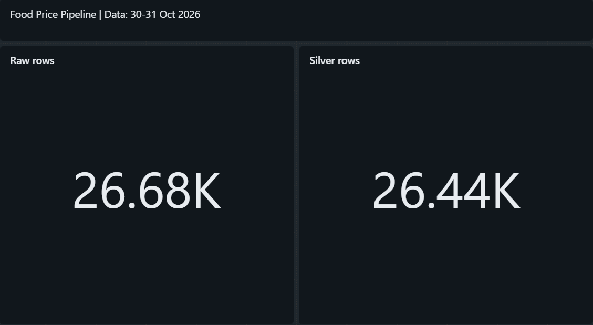
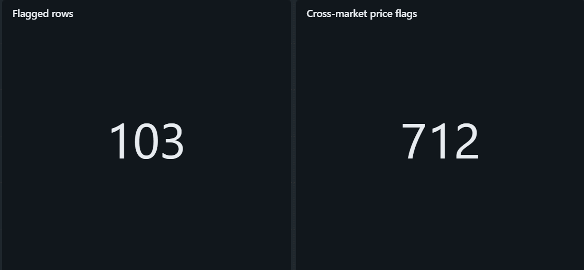
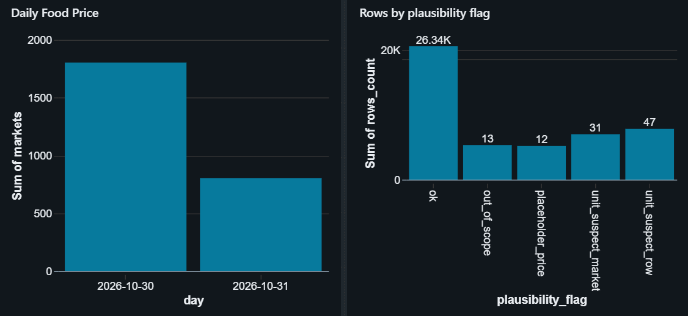
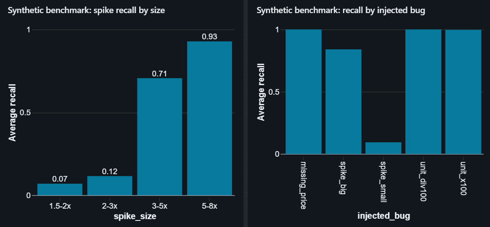
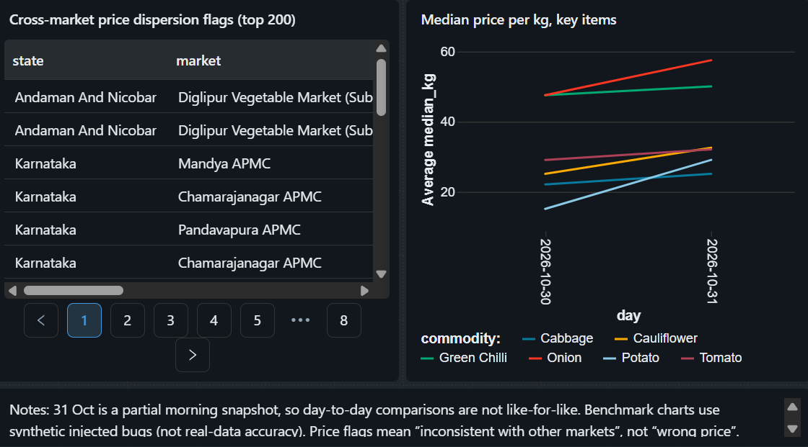

# Hyperlocal Food Price Intelligence Pipeline

A data pipeline that ingests daily mandi (wholesale market) prices from India's open
data portal, cleans and standardises them, flags unit errors, duplicates and
suspicious prices, and publishes quality-checked market-level price tables to a dashboard.

Built with Python, AWS S3, Databricks (PySpark + Delta Lake).

> **Status:** working end to end on **2 days of real data (30-31 Oct 2026)**.
> Time-series spike detection needs more history and is listed under *Next steps*.

## Dashboard

<p align="center">
  
  
</p>

<p align="center">
  
  
</p>

<p align="center">
  
</p>

## Architecture

```
data.gov.in (Agmarknet API)
        |
 Python extractor (pagination, retries)        <- laptop
        |
        +--> AWS S3  (raw parquet archive, ingest_date partitions)
        |
        +--> Databricks Volume (same files)
                  |
          Bronze (Delta)  raw, untouched, + source file
                  |
          Silver (Delta)  typed, deduplicated, validated, flagged
                  |
          Gold (Delta)    market x commodity x day, quality flags
                  |
          Databricks AI/BI Dashboard
```

Databricks Free Edition restricts outbound internet and custom storage locations,
so S3 is used as the raw archive/backup and the same files are uploaded to a
Databricks Volume, which Bronze reads from.

## Data

- **Source:** data.gov.in, "Current Daily Price of Various Commodities from Various
  Markets (Mandi)" (Agmarknet). Prices are in Rs per quintal; the pipeline also
  stores Rs per kg (quintal / 100).
- **Coverage in Silver (30-31 Oct 2026):** 29 states, 1,900 markets, 259 commodities.
- **Important:** the API returns only the current day. History has to be built by
  running the extractor every day. The 31 Oct file was pulled in the morning and
  has fewer rows (9,561) than the 30 Oct evening pull (17,115), because markets
  upload data throughout the day.

## Measured results on real data

| Metric | Value |
|---|---|
| Raw rows | 26,676 |
| Exact duplicates removed | 237 (0.89%) |
| Conflicting duplicates (same key, different price) | 0 |
| Rows rejected by basic validation | 0 |
| Silver rows | 26,439 |
| Rows flagged in Silver v2 | 103 (0.39%) |
| Market-commodity-days in clean Gold | 25,498 |
| Of which flagged as cross-market price dispersion | 712 |
| Series seen on both days with unchanged modal price | 4,905 of 8,391 (58%) |

Flag breakdown in Silver v2: 47 `unit_suspect_row`, 31 `unit_suspect_market`,
13 `out_of_scope`, 12 `placeholder_price`.

Notes on how to read these:

- All 237 duplicates were in the 30 Oct file and were exact copies. The cause is not
  confirmed (page overlap while the API data changed during extraction is one
  hypothesis); tracing page offsets is a next step.
- The dispersion flag (>= 3x or <= 0.33x of the national median for that commodity)
  means "inconsistent with other markets", **not** "wrong price" or "spike". Variety
  and grade mixing and real regional differences also trigger it.
- Prices that stay identical for two days are common (58% of series), so a one-day
  deviation alone is not treated as a spike.
- 31 Oct is a partial morning snapshot, so day-to-day comparisons are not like-for-like.

## Data quality issues found in the real data

- **Unit inconsistency at market level:** some markets (for example Patti APMC,
  Jeerapur) appear to quote prices in a different unit for most items. Unit rules are
  evaluated per market (median ratio of its items to the national median) and the
  affected rows are flagged `unit_suspect_market`. They are **not** auto-corrected,
  because the true unit cannot be proven from the data (kg-style numbers vs per-piece).
- **Placeholder prices:** values below Rs 1 per quintal (for example 0.01) are flagged
  `placeholder_price`.
- **Out-of-scope items:** `Wood` (timber) and `Cock` (poultry) are flagged `out_of_scope`.
- **Naming drift:** state names such as `Keralam`/`Kerala` and `Chattisgarh` are mapped
  to a standard form.

## Benchmark (synthetic, labelled)

Bugs were injected into rows the rules consider clean (300 of each type, seed 42,
about 6% anomaly rate) and the same pipeline rules were run on them. **This measures
the rules against known injected bugs; it is not accuracy on real data.**

| Injected bug | Injected | Caught | Recall |
|---|---|---|---|
| Missing price | 300 | 300 | 1.00 |
| Unit x100 | 300 | 299 | 0.997 |
| Unit /100 | 300 | 300 | 1.00 |
| Spike 3-8x | 300 | 252 | 0.84 |
| Spike 1.5-2.5x | 300 | 28 | 0.093 |
| Exact duplicates | 300 | 300 removed | 1.00 |

Spike recall by size: 1.5-2x: 0.069, 2-3x: 0.115, 3-5x: 0.706, 5-8x: 0.928.

False alarms on clean rows: 103 of 23,482 (0.439%); precision 0.920 at the 6%
anomaly rate used here. All 103 are cross-market dispersion (`price_outlier`) flags;
only 13 of them share a market-commodity-day with an injected row. A likely cause
(not verified) is that injected rows shift the national median slightly, pushing
clean rows that sit near the 3x / 0.33x threshold over it. Precision depends on how
common anomalies are, so it would be lower if real anomalies are rarer.

Why unit and missing-price recall is near perfect: those rules were designed for
exactly these bug types, so this confirms the rules work, not that every unit
mismatch would be caught. The detection threshold is 3x, so spikes below 3x are
mostly missed by design; catching them needs a time-based baseline.

## Late-arriving corrections

A Delta `MERGE` demo applies corrected prices to existing rows (50 simulated
corrections on a copy of Silver). The row count stayed at 26,439 (updates, not
inserts), and the earlier version is still readable with Delta time travel
(`VERSION AS OF 0`). The corrections are simulated, not real late data.

## Project structure

```
src/
  extract_mandi.py      paginated extraction, retries, parquet + S3 upload
  upload_existing.py    upload previously saved raw files to S3
  test_api.py           API connectivity test
  test_headers.py       compares default vs browser User-Agent
  test_s3.py            S3 permission test
notebooks/
  00_setup.ipynb        Bronze -> Silver -> Gold, flags, benchmark, MERGE demo, dashboard tables
docs/
  dashboard_1.png ... dashboard_5.png
.env.example
requirements.txt
```

## Run it

1. Create a virtual environment and install dependencies:
   ```
   python -m venv .venv
   .venv\Scripts\activate
   python -m pip install -r requirements.txt
   ```
2. Copy `.env.example` to `.env` and fill in your keys.
3. Pull data (writes a parquet file under `data/raw/` and uploads it to S3):
   ```
   python src/extract_mandi.py
   ```
4. Upload the parquet files to a Databricks Volume
   (`workspace.food_price.raw_files`) and run the notebook cells in order.

Notes:

- The data.gov.in gateway timed out for the default `python-requests` User-Agent but
  answered with browser-like headers, so the extractor sends those headers.
- On Windows, use `python -m pip` (a policy on the development machine blocked `pip.exe`).

## Known limitations

- Only 2 days of history, so no time-series baseline yet.
- Extraction is run manually from a laptop (Databricks Free Edition restricts
  outbound internet).
- Unit-suspect rows are flagged, not corrected.
- The market-level unit cutoff (median ratio < 0.05) is hand-picked. For example,
  Morena APMC on 31 Oct has a ratio of 0.0517, just above the cutoff, so it is not
  flagged as unit-suspect.
- Dispersion flags use a commodity-level median, so variety and grade mixing
  produces some noise.
- Benchmark figures are synthetic; real-data precision is not measured because
  there are no ground-truth labels.

## Next steps

- Run the extractor daily to build history, then add a rolling median/MAD
  per market and commodity.
- Record the API page offset per row to trace the cause of duplicates.
- Schedule Bronze -> Silver -> Gold as a Databricks Workflow.
- Compare mandi prices with retail prices (Department of Consumer Affairs).
- Add weather and festival features.
